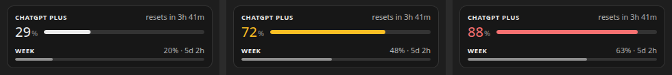

# ChatGPT Usage for VS Code

Your ChatGPT plan's Codex limits in a small card in the VS Code sidebar: the 5-hour window and the week, each with the time until it resets. It was made to sit under [Clawd Usage](https://github.com/LaineyLouiseWard/clawd-usage-vscode), which does the same for a Claude plan, and works on its own.

Unofficial project, not made by or affiliated with OpenAI.

## What it shows

- The plan name, the 5-hour window as a number and a bar, and the time until it resets. The number turns yellow at 60% and red at 85%; otherwise the card stays black and white.
- The weekly limit with its reset time.

## Install

You need [Codex](https://github.com/openai/codex) signed in with a ChatGPT plan.

1. Download `chatgpt-usage-<version>.vsix` from the [releases page](https://github.com/LaineyLouiseWard/chatgpt-usage-vscode/releases).
2. Run `code --install-extension chatgpt-usage-<version>.vsix`, or in VS Code open the Extensions view, click its `…` menu and choose *Install from VSIX…*.
3. Open the Explorer. ChatGPT Usage is a section at the bottom, which you can drag into the bottom panel or another sidebar.

Settings live under *ChatGPT Usage* in VS Code's settings: the refresh interval, the yellow and red levels, and the path to `codex`.

## How it gets the numbers

Every 60 seconds it starts `codex app-server`, asks it for the plan's limits (`account/rateLimits/read`) and closes it. That calls no model, so it uses none of your limits. It uses the `codex` on your PATH, then nvm's folders, or the path in the `chatgptUsage.codexPath` setting.

## Structure

- `extension.js` runs inside VS Code. It finds `codex`, reads the limits and runs the view.
- `media/main.js` and `media/style.css` draw the card.

It is plain JavaScript and runs as written. To package it, run `npx @vscode/vsce package`.

## Related

- [Clawd Usage for VS Code](https://github.com/LaineyLouiseWard/clawd-usage-vscode): Claude plan usage with Clawd the crab.
- [Clawd Usage for Linux](https://github.com/LaineyLouiseWard/clawd-usage-linux): the same Clawd as a desktop widget.

## Licence

MIT. See [LICENSE](LICENSE).
